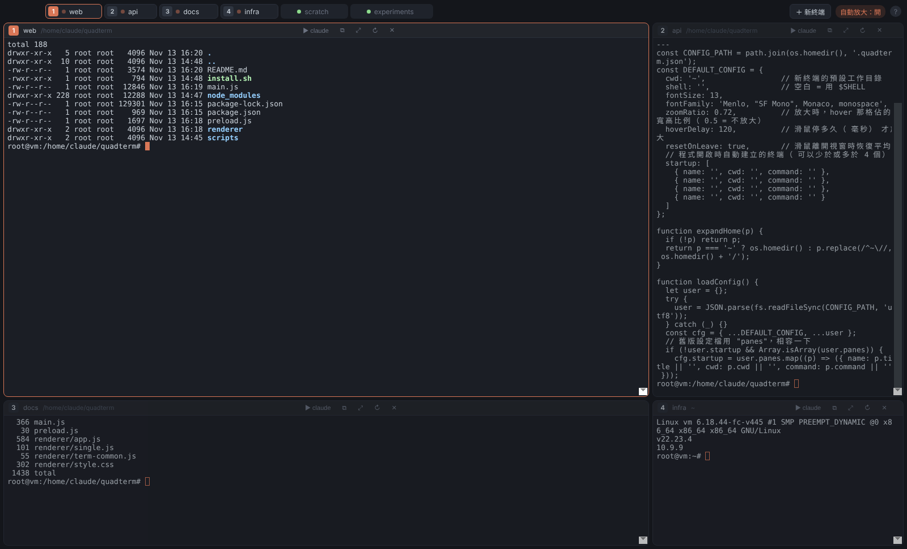
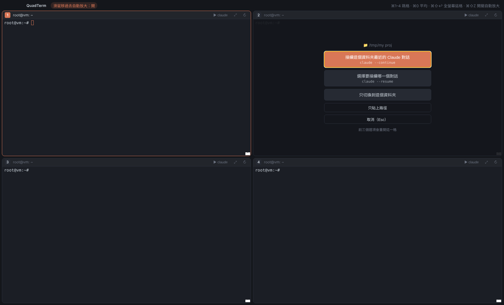

<div align="center">

# QuadTerm

**A 2×2 terminal grid for macOS, built for running several Claude Code sessions at once.**

**English** · [繁體中文](README.zh-TW.md)



</div>

## Why

Running several Claude Code sessions usually means juggling a pile of terminal windows. QuadTerm puts them all in one window:

- **Four panes, evenly split.** Hover over a pane and it grows. Your keyboard focus follows the mouse.
- **As many terminals as you want.** Every terminal appears in the list at the top. The grid always shows the four you used most recently.
- **Pop out any terminal** into its own window. Close that window and the terminal goes back to the list, still running.
- **See which sessions are busy or done.** Background terminals keep running. Their list entry shows a pulsing dot while output is streaming and a green dot when output has stopped and you haven't looked yet. It's an easy way to tell when Claude has finished.

## Features

> The interface is in Traditional Chinese for now.


| | |
|---|---|
| 🖱 **Hover to zoom** | The pane under the mouse expands (66% by default), and its text gets bigger. It returns to an even split when the mouse leaves the window. |
| 🗂 **Unlimited terminals** | Click a terminal in the list to put it on screen. It replaces the least recently used pane. |
| ⧉ **Pop-out windows** | Drag a terminal out of the window, or click ⧉. Scrollback and the running process are preserved. |
| 📁 **Resume Claude from a folder** | Drop a folder on a pane, for example the folder icon in Terminal.app's title bar, to run `claude --continue` there. |
| 🔁 **Rearrange panes** | Drag a terminal from the list onto a pane. If it was already on screen, the two panes swap. |
| ⌨️ **Claude Code friendly** | `⇧↩` inserts a newline. Option works as Meta. Each pane has a one-click **▶ claude** button. |
| ✏️ **Rename** | Double-click a name in the list. By default, a terminal is named after its current folder. |

## Install (macOS)

Requires [Node.js](https://nodejs.org) 18 or newer (`brew install node`).

```bash
git clone https://github.com/tom-riddle-sr/quadterm.git
cd quadterm
bash install.sh
```

`install.sh` installs dependencies, builds `QuadTerm.app`, and copies it to `/Applications` (or to `~/Applications` if `/Applications` isn't writable). Launch it from Spotlight.

You don't need Xcode. `node-pty` ships prebuilt binaries for Apple Silicon and Intel.

To run it without installing:

```bash
npm install
npm start
```

## Usage

| Action | What it does |
|---|---|
| Hover a pane | Zoom it and focus it |
| Click a terminal in the list | Show it on screen (or jump to it if it's already visible) |
| Drag a terminal onto a pane | Put it in that pane |
| Drag a terminal outside the window | Pop it out into its own window |
| Drop a folder on a pane | Choose: `claude --continue`, `claude --resume`, or a plain shell in that folder |
| Drop files on a pane | Paste their paths (shell-quoted) |
| Double-click a name in the list | Rename it |

### Keyboard shortcuts

| Shortcut | Action |
|---|---|
| `⌘T` / `⌘W` | New terminal / close the current terminal |
| `⌘⇧[` / `⌘⇧]` | Previous / next terminal |
| `⌘1` – `⌘4` | Focus pane 1–4 |
| `⌘⇧D` | Pop the current terminal out (in a pop-out window: dock it back) |
| `⌘0` | Reset to an even split |
| `⌘⇧↩` | Maximize the current pane / restore |
| `⌘⇧Z` | Toggle hover-to-zoom |
| `⌘C` / `⌘V` / `⌘K` | Copy / paste / clear |
| `⌘+` / `⌘-` | Larger / smaller font |
| `⌘⇧R` | Restart the current terminal |
| `⇧↩` | Newline (multi-line input in Claude Code) |

## Moving over from Terminal.app

A running process can't move from one app to another. Claude Code conversations live per folder, though, so you can pick one up in QuadTerm:

1. In the old Terminal window, drag the small **folder icon** in the title bar.
2. Drop it on a QuadTerm pane.
3. Press **Enter** to run `claude --continue` in that folder.



## Configuration

Choose **版面 (Layout) → 開啟設定檔 (Open config file)** in the menu bar to create `~/.quadterm.json`. Restart QuadTerm to apply changes.

```json
{
  "cwd": "~/projects",
  "zoomRatio": 0.66,
  "hoverDelay": 120,
  "animationMs": 160,
  "resetOnLeave": true,
  "fontSize": 13,
  "startup": [
    { "name": "web",  "cwd": "~/projects/web", "command": "claude" },
    { "name": "api",  "cwd": "~/projects/api", "command": "claude" },
    { "name": "test", "cwd": "", "command": "" },
    { "name": "git",  "cwd": "", "command": "" }
  ]
}
```

| Key | Default | Description |
|---|---|---|
| `startup` | 4 empty shells | Terminals created at launch. The first four go on screen and the rest go to the list. |
| `startup[].command` | `""` | Command to run when the terminal starts, e.g. `claude` |
| `cwd` | `~` | Working directory for new terminals |
| `zoomRatio` | `0.66` | Share of width and height given to the zoomed pane (`0.5` turns zoom off) |
| `zoomMode` | `"font"` | `"font"` scales the text and keeps every terminal's rows and columns fixed, so programs like Claude Code never redraw or flicker when you switch panes. `"resize"` gives the zoomed pane more rows and columns instead, but every switch makes each program redraw. |
| `hoverDelay` | `120` | Milliseconds the mouse must rest on a pane before it zooms |
| `animationMs` | `160` | Length of the zoom animation in milliseconds (`0` switches instantly) |
| `resetOnLeave` | `true` | Return to an even split when the mouse leaves the window |
| `shell` | `$SHELL` | Shell to launch. It starts as a login shell, so your `PATH` is loaded. |

## Troubleshooting

- **`posix_spawnp failed`**: Run `chmod +x node_modules/node-pty/prebuilds/darwin-*/spawn-helper`, then run `bash install.sh` again.
- **`claude: command not found`**: QuadTerm starts a login shell. Make sure the `PATH` entry for `claude` is in `~/.zprofile`, `~/.zshrc`, or `~/.bash_profile`.
- **"App is damaged"**: The app is ad-hoc signed and not notarized. Run `xattr -cr /Applications/QuadTerm.app`.

## Built with

[Electron](https://www.electronjs.org) · [xterm.js](https://xtermjs.org) with its WebGL renderer · [node-pty](https://github.com/microsoft/node-pty)

## License

[MIT](LICENSE)
