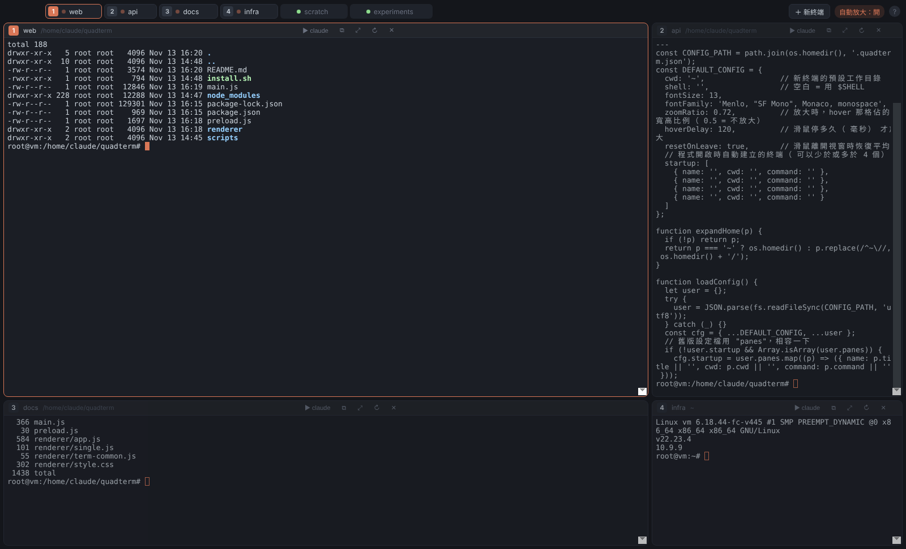
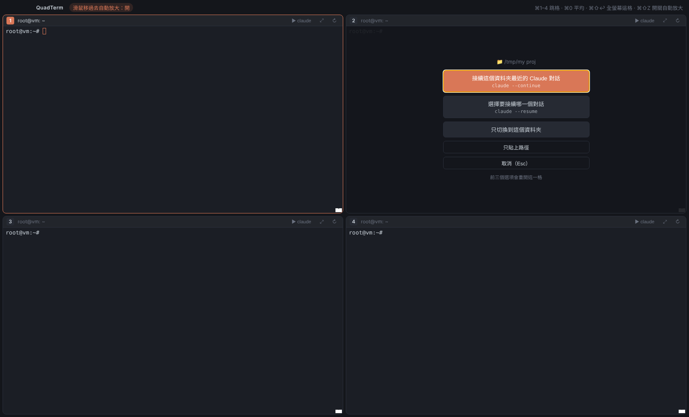

<div align="center">

# QuadTerm

**macOS 上的四格終端機，專為同時跑好幾個 Claude Code 設計。**

[English](README.md) · **繁體中文**



</div>

## 為什麼要做這個

同時開好幾個 Claude Code，桌面上就會堆滿終端機視窗，一直開開關關、切來切去。QuadTerm 把它們全部放進一個視窗：

- **四格平均分配**，滑鼠移到哪格那格就放大，鍵盤輸入也跟著過去。
- **終端數量不限**。所有終端都在上方列表，畫面上永遠顯示你最近用的 4 個。
- **任何一個都能拉出成獨立視窗**。關掉獨立視窗，終端會回到列表，裡面的程式繼續跑。
- **一眼看出哪個 Claude 做完了**。沒顯示在畫面上的終端會在背景繼續跑；正在輸出時列表上的點會閃爍，輸出停下來、內容還沒看時會變綠點。

## 功能

| | |
|---|---|
| 🖱 **滑鼠移過去自動放大** | 滑鼠所在那格放大（預設 66%），字也跟著變大；滑鼠離開視窗就恢復平均 |
| 🗂 **終端數量不限** | 點列表上的終端就會顯示到畫面上，取代最久沒用的那格 |
| ⧉ **拉出成獨立視窗** | 把終端拖到視窗外，或按 ⧉，畫面內容和正在跑的程式都保留 |
| 📁 **從資料夾接續 Claude 對話** | 把資料夾（例如 Terminal 標題列上的資料夾圖示）拖進某格，就在那裡執行 `claude --continue` |
| 🔁 **自由排列** | 把列表上的終端拖到某一格就放進那格；如果它原本就在畫面上，兩格會互換 |
| ⌨️ **為 Claude Code 調整** | `⇧↩` 換行、Option 當 Meta 鍵、每格都有一鍵 **▶ claude** 按鈕 |
| ✏️ **改名** | 雙擊列表上的名稱；沒改名時，預設顯示終端目前所在的資料夾名稱 |

## 安裝（macOS）

需要 [Node.js](https://nodejs.org) 18 以上（`brew install node`）。

```bash
git clone https://github.com/tom-riddle-sr/quadterm.git
cd quadterm
bash install.sh
```

`install.sh` 會安裝套件、打包出 `QuadTerm.app`，再複製到 `/Applications`（沒有寫入權限時改放 `~/Applications`）。之後用 Spotlight 搜尋 QuadTerm 開啟即可。

不需要安裝 Xcode，`node-pty` 已經附帶 Apple Silicon 和 Intel 的預編譯檔。

只想先試跑、不安裝：

```bash
npm install
npm start
```

## 操作

| 動作 | 效果 |
|---|---|
| 滑鼠移到某格 | 那格放大，焦點也切過去 |
| 點列表上的終端 | 顯示到畫面上（已在畫面上就跳過去） |
| 把列表上的終端拖到某格 | 放進那一格 |
| 把列表上的終端拖到視窗外 | 拉出成獨立視窗 |
| 把資料夾拖進某格 | 選擇 `claude --continue`、`claude --resume`，或開一個在該資料夾的終端 |
| 把檔案拖進某格 | 貼上檔案路徑（自動加引號） |
| 雙擊列表上的名稱 | 改名 |

### 快捷鍵

| 快捷鍵 | 功能 |
|---|---|
| `⌘T`／`⌘W` | 開新終端／關閉目前終端 |
| `⌘⇧[`／`⌘⇧]` | 上一個／下一個終端 |
| `⌘1` – `⌘4` | 跳到第 1–4 格 |
| `⌘⇧D` | 目前終端拉出成獨立視窗（在獨立視窗裡按是收回） |
| `⌘0` | 恢復四格平均 |
| `⌘⇧↩` | 目前這格全螢幕／還原 |
| `⌘⇧Z` | 開關「滑鼠移過去自動放大」 |
| `⌘C`／`⌘V`／`⌘K` | 複製／貼上／清除畫面 |
| `⌘+`／`⌘-` | 字放大／縮小 |
| `⌘⇧R` | 重新啟動目前終端 |
| `⇧↩` | 換行（Claude Code 多行輸入） |

## 從 Terminal.app 搬過來

正在執行的程式沒辦法從一個 app 搬到另一個 app，但 Claude Code 的對話是跟著資料夾存的，所以可以在 QuadTerm 接著用：

1. 在舊的 Terminal 視窗，拖曳標題列上的**小資料夾圖示**
2. 放到 QuadTerm 的某一格
3. 按 **Enter**，就會在那個資料夾執行 `claude --continue`



## 設定

選單「版面 → 開啟設定檔」會建立 `~/.quadterm.json`，改完後重開 QuadTerm 套用。

```json
{
  "cwd": "~/projects",
  "zoomRatio": 0.66,
  "hoverDelay": 120,
  "animationMs": 160,
  "resetOnLeave": true,
  "fontSize": 13,
  "startup": [
    { "name": "前端", "cwd": "~/projects/web", "command": "claude" },
    { "name": "後端", "cwd": "~/projects/api", "command": "claude" },
    { "name": "測試", "cwd": "", "command": "" },
    { "name": "git",  "cwd": "", "command": "" }
  ]
}
```

| 設定 | 預設 | 說明 |
|---|---|---|
| `startup` | 4 個空白終端 | 開啟時自動建立的終端，可以超過 4 個；前 4 個放在畫面上，其餘放在列表 |
| `startup[].command` | `""` | 終端建立時自動執行的指令，例如 `claude` |
| `cwd` | `~` | 新終端的預設工作目錄 |
| `zoomRatio` | `0.66` | 放大那格佔的寬高比例（`0.5` = 不放大） |
| `zoomMode` | `"font"` | `"font"`：放大時只放大字，終端行列數不變，所以切換時 claude 等程式不會重畫、不會閃。`"resize"`：放大的那格會有更多行列、看得到更多內容，但每次切換程式都會重畫 |
| `hoverDelay` | `120` | 滑鼠要在某格停多少毫秒才放大 |
| `animationMs` | `160` | 放大動畫長度（毫秒），`0` = 不要動畫、直接切換 |
| `resetOnLeave` | `true` | 滑鼠離開視窗時恢復平均 |
| `shell` | `$SHELL` | 要用的 shell，會以登入 shell 啟動，所以會載入你的 `PATH` |

## 疑難排解

- **出現 `posix_spawnp failed`**：執行 `chmod +x node_modules/node-pty/prebuilds/darwin-*/spawn-helper`，再重跑一次 `bash install.sh`。
- **`claude: command not found`**：QuadTerm 用登入 shell 啟動，請確認 `claude` 的 `PATH` 設在 `~/.zprofile`、`~/.zshrc` 或 `~/.bash_profile` 裡。
- **顯示「App 已損毀」**：這個 app 只有 ad-hoc 簽章、沒有經過 Apple 公證，執行 `xattr -cr /Applications/QuadTerm.app` 即可。

## 使用技術

[Electron](https://www.electronjs.org) · [xterm.js](https://xtermjs.org)（WebGL 繪製）· [node-pty](https://github.com/microsoft/node-pty)

## 授權

[MIT](LICENSE)
